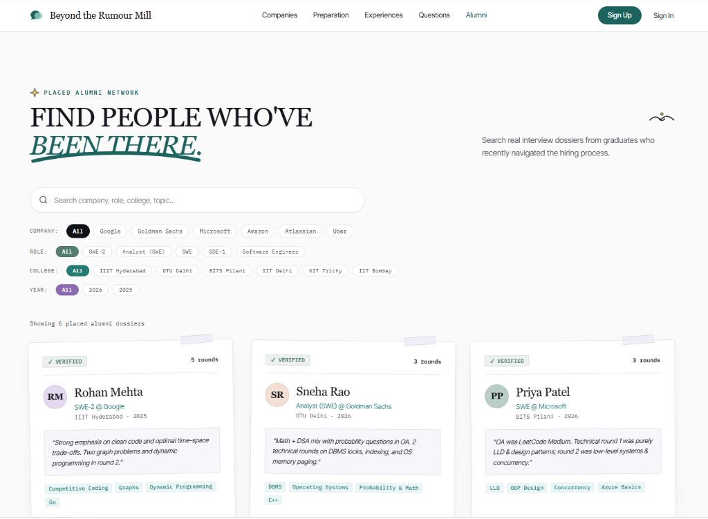
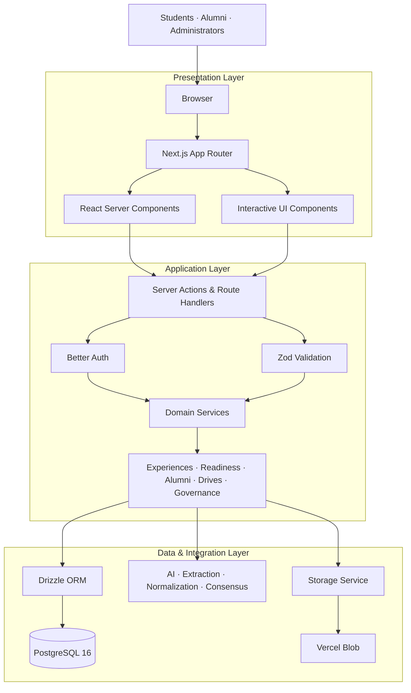
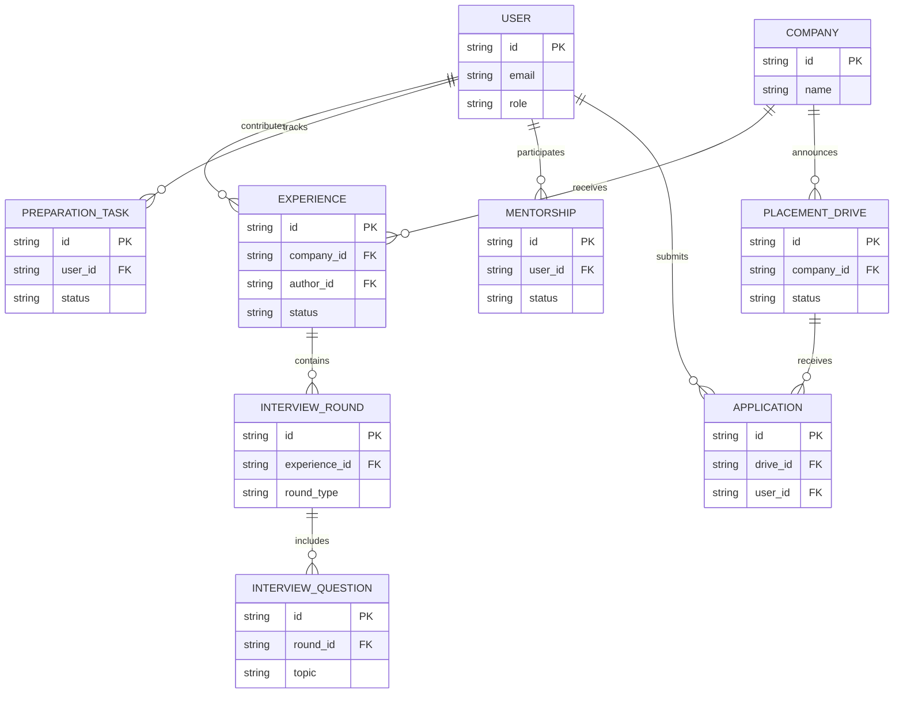

<!-- ====================================================== -->
<!--                    PROJECT HEADER                     -->
<!-- ====================================================== -->

<div align="center">

# 🎓 Beyond the Rumour Mill

### Campus Placement & Interview Intelligence Platform

**Less hearsay. More signal. Better preparation.**

Turn scattered placement experiences into structured, searchable, and actionable career intelligence.

<p>
  <a href="https://beyond-the-rumour-mill-main-mws322y1b-jyatin1.vercel.app">
    
  </a>
</p>

<p>
  
  
  
  
  
  
</p>

<p>
  <a href="#-overview">Overview</a> ·
  <a href="#-product-preview">Preview</a> ·
  <a href="#-features">Features</a> ·
  <a href="#-system-architecture">Architecture</a> ·
  <a href="#-engineering">Engineering</a> ·
  <a href="#-project-structure">Structure</a> ·
  <a href="#-team--contribution">Team</a>
</p>

</div>

---

## ⚡ 30-Second Overview

### What is Beyond the Rumour Mill?

Campus placement knowledge is often fragmented across WhatsApp groups, informal conversations, old notes, and second-hand interview stories. Candidates struggle to understand which information is relevant, current, or trustworthy.

**Beyond the Rumour Mill** is a campus placement intelligence platform that brings interview experiences, company insights, preparation resources, alumni guidance, and placement opportunities into one organised space.

The platform is designed to help students move from *“I heard this company asks these questions”* to *“I understand the hiring process, the available evidence, and how to prepare.”*

| The usual placement experience | What the platform enables |
|---|---|
| Scattered messages and outdated notes | Structured, searchable interview experiences |
| Unclear source and reliability | Context, review, and verification workflows |
| Repeated questions across batches | A reusable interview question repository |
| Unstructured preparation | A personal candidate readiness workspace |
| Difficult access to relevant seniors | Alumni discovery and mentorship pathways |

---

## 📸 Product Preview

A look at the platform's interface and key product areas.

<table>
  <tr>
    <td align="center" width="100%" colspan="2">
      
      <br />
      <strong>01 · Editorial Homepage</strong>
      <br />
      <sub>A central starting point for placement intelligence and platform discovery.</sub>
    </td>
  </tr>
  <tr>
    <td align="center" width="50%">
      
      <br />
      <strong>02 · Company Intelligence</strong>
      <br />
      <sub>Company-specific interview rounds, reported questions, and hiring context.</sub>
    </td>
    <td align="center" width="50%">
      
      <br />
      <strong>03 · Candidate Readiness</strong>
      <br />
      <sub>A focused space for preparation tasks and progress.</sub>
    </td>
  </tr>
</table>

---

## ✨ Features

<table>
  <tr>
    <td width="50%" valign="top">
      <h3>🧠 Interview Intelligence</h3>
      <ul>
        <li>Structured interview experience submissions</li>
        <li>Company and role-specific hiring insights</li>
        <li>Interview round and question discovery</li>
        <li>Experience normalization and consensus signals</li>
      </ul>
    </td>
    <td width="50%" valign="top">
      <h3>🔎 Trust & Verification</h3>
      <ul>
        <li>Evidence-aware experience review</li>
        <li>Moderation and reporting workflows</li>
        <li>Verification and reputation signals</li>
        <li>Anonymous public contribution support</li>
      </ul>
    </td>
  </tr>
  <tr>
    <td width="50%" valign="top">
      <h3>📚 Candidate Readiness</h3>
      <ul>
        <li>Personal preparation workspace</li>
        <li>DSA and core CS preparation tasks</li>
        <li>Interview question repository</li>
        <li>Readiness-oriented progress tracking</li>
      </ul>
    </td>
    <td width="50%" valign="top">
      <h3>🤝 Alumni & Community</h3>
      <ul>
        <li>Alumni discovery by company and expertise</li>
        <li>Community Q&A and discussion flows</li>
        <li>Mentorship and mock interview pathways</li>
        <li>Peer-driven career guidance</li>
      </ul>
    </td>
  </tr>
  <tr>
    <td width="50%" valign="top">
      <h3>🏢 Placement Operations</h3>
      <ul>
        <li>Placement drive announcements</li>
        <li>Eligibility and application information</li>
        <li>Student application workflows</li>
        <li>Administrative review and moderation</li>
      </ul>
    </td>
    <td width="50%" valign="top">
      <h3>⚙️ Platform Foundations</h3>
      <ul>
        <li>Authentication and role-aware operations</li>
        <li>Relational data model with PostgreSQL</li>
        <li>Typed database access through Drizzle ORM</li>
        <li>Automated test and quality-check foundation</li>
      </ul>
    </td>
  </tr>
</table>

> [!NOTE]
> The repository is under active development. Feature descriptions represent the platform's implemented foundations and product scope; individual workflows may still be evolving.

---

## 🏗️ System Architecture

Beyond the Rumour Mill follows a **modular monolith** architecture. The application is organised into distinct product domains inside one Next.js codebase, with shared authentication, database, storage, and infrastructure layers.

### High-level architecture



### How a request flows

1. **Interact:** A student or alumnus uses the Next.js application.
2. **Route:** The App Router renders the relevant page or directs a mutation to a Server Action or Route Handler.
3. **Authenticate & validate:** Better Auth provides session context; Zod validates incoming data, and server-side checks enforce access rules.
4. **Process:** Domain logic executes the relevant experience, company, readiness, alumni, placement, or moderation workflow.
5. **Persist:** Drizzle ORM performs typed database operations against PostgreSQL. File and evidence assets are handled through the storage integration.
6. **Respond:** The application returns the updated state or rendered data to the user.

### Team module boundaries

| Ownership area | Responsibilities |
|---|---|
| **Module 1 — Experience Intelligence** | Experience capture, company dossiers, interview rounds, normalization, extraction, and consensus |
| **Module 2 — Candidate Readiness & Community** | Preparation hub, readiness calculations, questions, alumni discovery, and mentorship |
| **Module 3 — Drives & Governance** | Placement drives, applications, verification, CV/evidence workflows, and moderation |
| **Shared Platform Core** | Authentication, database infrastructure, shared contracts, UI conventions, storage, and deployment |

### Data model at a glance

The platform's relational model connects the people, companies, and hiring information that power its discovery and preparation workflows.



> The diagrams are conceptual views of the system and domain relationships, not exhaustive deployment or database-schema specifications.

---

## 🛡️ Engineering & Quality

The project emphasises data integrity, server-side validation, and clear ownership boundaries.

| Area | Approach |
|---|---|
| **Authentication** | Better Auth manages user identity and sessions |
| **Authorization** | Server-side role and ownership checks protect sensitive operations |
| **Input validation** | Zod schemas validate incoming application data |
| **Data integrity** | PostgreSQL constraints, relational modelling, and transactional writes |
| **Database access** | Drizzle ORM provides typed queries and schema migrations |
| **Evidence & privacy** | Review workflows and controlled access for sensitive evidence and CV resources |
| **Testing** | Vitest suites cover core application and data workflows |
| **Code quality** | TypeScript checks and ESLint support maintainability |

The current project documentation reports **24 passing Vitest test suites**. Test coverage and integration checks should continue to evolve alongside the product modules.

---

## 🧰 Technology Stack

| Layer | Technologies |
|---|---|
| **Application Framework** | [Next.js 16](https://nextjs.org/) · [React 19](https://react.dev/) |
| **Language** | [TypeScript](https://www.typescriptlang.org/) |
| **Styling & UI** | [Tailwind CSS 4](https://tailwindcss.com/) · [Radix UI](https://www.radix-ui.com/) · [Lucide](https://lucide.dev/) |
| **Authentication** | [Better Auth](https://www.better-auth.com/) |
| **Database** | [PostgreSQL 16](https://www.postgresql.org/) |
| **ORM & Migrations** | [Drizzle ORM](https://orm.drizzle.team/) |
| **Validation** | [Zod](https://zod.dev/) |
| **Email** | [Resend](https://resend.com/) |
| **File Storage** | [Vercel Blob](https://vercel.com/docs/vercel-blob) |
| **Testing** | [Vitest](https://vitest.dev/) |
| **Deployment** | [Vercel](https://vercel.com/) |

### Why a modular monolith?

- **Simpler operations:** One application is easier to develop, test, and deploy than multiple independently operated services.
- **Clear domain boundaries:** Feature modules keep ownership and business logic organised.
- **Shared consistency:** Modules use common authentication, contracts, database infrastructure, and validation patterns.
- **Room to evolve:** Individual domains can be extracted into services later if scale or operational needs justify it.

---

## 📂 Project Structure

The repository uses a feature-oriented structure. Pages and routes live in the Next.js App Router, reusable UI is grouped by product area, and server-side business logic is separated into domain-focused modules.

```text
beyond-the-rumour-mill-team/
├── contracts/                   # Shared contracts across modules
│   ├── auth-helpers.ts
│   ├── auth-schema.ts
│   └── notifications.ts
├── screenshots/                 # README and product screenshots
├── src/
│   ├── app/                      # App Router pages and API routes
│   │   ├── admin/                # Placement administration & moderation
│   │   ├── alumni/               # Alumni discovery
│   │   ├── companies/            # Company directory and dossiers
│   │   ├── experiences/          # Submit, browse, and view experiences
│   │   ├── prepare/              # Candidate preparation workspace
│   │   ├── questions/            # Interview question repository
│   │   └── ...                   # Profile, connect, privacy, and more
│   ├── components/               # Reusable feature components
│   └── server/                   # Server-only application logic
│       ├── actions/              # Mutations and Server Actions
│       ├── ai/                   # Extraction and AI provider logic
│       ├── consensus/            # Experience aggregation
│       ├── db/schema/            # Module-specific database schemas
│       ├── normalization/        # Experience and question normalization
│       ├── qa/                   # Claims, ranking, and moderation rules
│       ├── queries/              # Database read operations
│       ├── readiness/            # Candidate readiness calculations
│       ├── reputation/           # Trust and reputation signals
│       ├── storage/              # File and evidence storage
│       └── validators/           # Server-side validation
├── tests/                        # Automated tests
├── .env.example                  # Environment variable template
├── TEAM_HANDOFF_GUIDE.md         # Team onboarding and ownership guide
└── README.md
```

### Where to look

- **Pages and routes:** `src/app/`
- **Feature UI:** `src/components/`
- **Write operations:** `src/server/actions/`
- **Read operations:** `src/server/queries/`
- **Database schemas:** `src/server/db/schema/`
- **AI and data processing:** `src/server/ai/`, `src/server/normalization/`, `src/server/consensus/`
- **Tests:** `tests/`

---

## 👥 Team & Contribution

The project is divided into three product modules so contributors can work in parallel with explicit file and schema ownership.

| Team area | Focus |
|---|---|
| **Module 1** | Experience capture and consensus intelligence |
| **Module 2** | Candidate readiness, Q&A, and alumni mentorship |
| **Module 3** | Placement operations, verification, and governance |
| **Platform Core** | Shared infrastructure, authentication, contracts, and integration |

### Contribution workflow

1. Read the [Team Handoff Guide](./TEAM_HANDOFF_GUIDE.md) before making changes.
2. Start from the agreed base branch and create your assigned feature branch.
3. Modify only the files and schema owned by your module.
4. Run the relevant tests and TypeScript checks before pushing.
5. Open a pull request and coordinate integration with the project lead.

**Important:** The handoff guide defines protected shared files and module-specific schema ownership. Follow it to avoid cross-team merge conflicts.

---

## 🚦 Project Status

- [x] Next.js application foundation
- [x] PostgreSQL and Drizzle ORM integration
- [x] Better Auth foundation
- [x] Module-oriented schema boundaries
- [x] Experience intelligence and data-processing foundations
- [x] Candidate readiness and community foundations
- [x] Placement and governance foundations
- [x] Automated test foundation
- [ ] Complete integration of all module workflows
- [ ] Expand end-to-end and production-readiness coverage

---

## 🔗 Project Links

- **Live Application:** [Open Beyond the Rumour Mill](https://beyond-the-rumour-mill-main-mws322y1b-jyatin1.vercel.app)
- **Team Handoff Guide:** [TEAM_HANDOFF_GUIDE.md](./TEAM_HANDOFF_GUIDE.md)
- **Repository:** [Jyatin/beyond-the-rumour-mill-team](https://github.com/Jyatin/beyond-the-rumour-mill-team)

---

## 👨‍💻 Maintainer

**Jyatin Singh**

- GitHub: [@Jyatin](https://github.com/Jyatin)
- LinkedIn: [Jyatin Singh](https://www.linkedin.com/in/jyatinsingh/)

---

<div align="center">

### Beyond the Rumour Mill

**Less hearsay. More signal. Better preparation.**

<sub>Built to make campus placement knowledge more transparent, useful, and accessible.</sub>

</div>
